# ad-export-audit

The first thing an Active Directory review looks for is not an exotic exploit, it is accounts: service accounts that can be Kerberoasted, users without pre-authentication, a long list of Domain Admins, privileged passwords nobody has changed since 2021. ad-export-audit reads a standard `Get-ADUser` export and lists them.



**Live demo:** https://jvch0512.github.io/ad-export-audit/ (a report on the synthetic export in `examples/`)

C# on .NET 8, no NuGet packages. It reads a CSV, so it never touches your directory and can run anywhere.

## Use

Export from a domain-joined machine:

```powershell
Get-ADUser -Filter * -Properties * | Select SamAccountName,Enabled,PasswordNeverExpires,PasswordLastSet,LastLogonDate,MemberOf,ServicePrincipalNames,UserAccountControl,DoesNotRequirePreAuth,TrustedForDelegation | Export-Csv users.csv -NoTypeInformation
```

Then:

```bash
dotnet build src -c Release -o out
dotnet out/ad-export-audit.dll users.csv
dotnet out/ad-export-audit.dll users.csv --html > report.html
dotnet out/ad-export-audit.dll users.csv --stale-days 60 --fail-on critical
```

Columns are matched by name, case-insensitively, and missing columns are tolerated. `MemberOf` can be full DNs or plain group names, separated by `;` or `|`. Use `--today YYYY-MM-DD` for reproducible reports.

| Rule | Severity | What it catches |
|---|---|---|
| AD001 | high, critical if privileged | enabled user accounts with an SPN (Kerberoasting) |
| AD002 | high, critical if privileged | Kerberos pre-authentication off (AS-REP roasting) |
| AD008 | critical or high | `PASSWD_NOTREQD`, reversible encryption, DES-only |
| AD006 | high | unconstrained delegation |
| AD003 | high | more than 5 enabled Domain Admins |
| AD004 | high | privileged accounts whose password never expires |
| AD005 | medium, high if privileged | enabled accounts with no logon for 90 days |
| AD007 | medium | privileged passwords older than a year |

See [examples/users.csv](examples/users.csv) and [docs/sample-output.txt](docs/sample-output.txt).

## Limits

- It audits an export of user accounts. ACLs, GPOs, trusts, delegation on computers and AD CS templates are outside its view, and those are where many real attack paths live.
- Only direct group membership in the export is considered. Nested groups need `Get-ADGroupMember -Recursive` first.
- `LastLogonDate` is replicated with a delay of up to 14 days, so borderline stale accounts can be false positives.

## Where it fits

First pass of an AD security review, audit evidence, a pre-sales discovery deliverable ("here is what your directory already says about you"), and a pentest report appendix.

## Tests

```bash
make test    # 33 checks
```

MIT.
